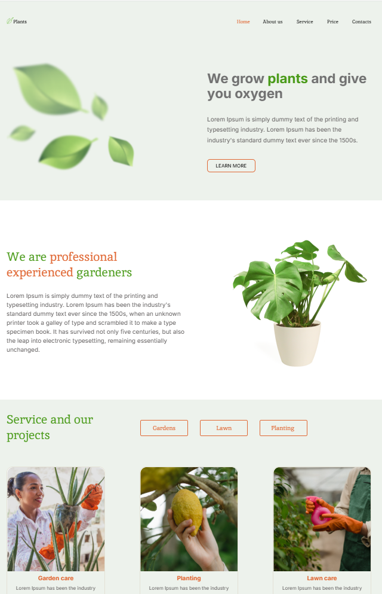

# Plants

*Landing for gardeners and plant lovers* is a one-page site that helps users find useful solutions for caring for plants,
arranging a garden and vegetable garden.
The page introduces the project, shows key features and advantages,
and also leads the visitor to the target action: subscription, ordering services, purchasing goods or consultation.

## [Figma layout](https://www.figma.com/design/ntVt8IwlwzfVFMBuVVAze8/Plants?node-id=0-1&p=f&t=inRB8v3wPkhcqj7t-0)

## [Deploy](https://intrstng.github.io/Plants/)

## Technologies
    - static landing page built using HTML and JavaScript
    - SCSS (using node-sass and sass-loader) for styling
    - bundled via Webpack 5 (with plugins and loaders)

## Screenshot
